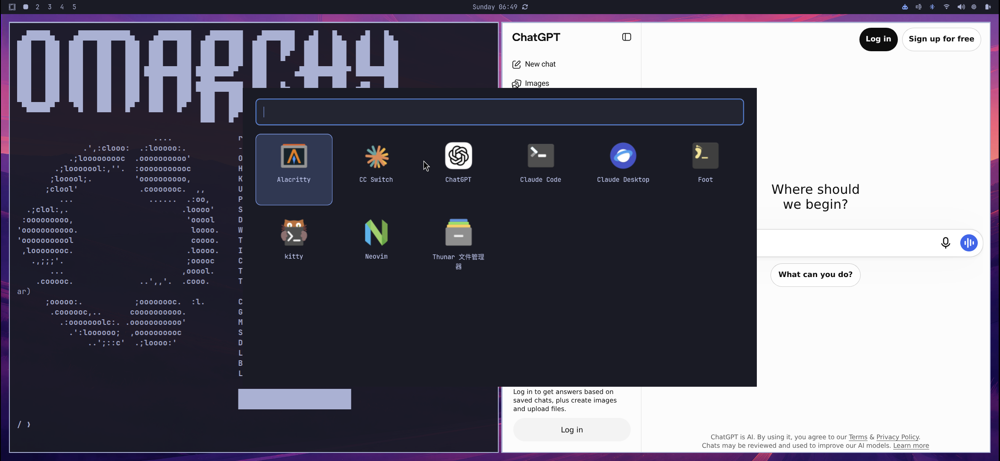

# Omarchy Android

将完整的 **Omarchy**（基于 `basecamp/omarchy`）原生 Wayland 桌面与 **ARM64 AI 桌面全家桶**（CC Switch / Codex Desktop / Claude Desktop / Hermes Desktop）运行在 Android 手机、折叠屏与平板上。

支持 **Root 原生 `chroot`（满血零损耗）** 与 **免 Root `proot-distro`（无需解锁 Bootloader）** 双引擎，不绑定特定机型，适用于绝大多数 ARM64 Android 10–15 设备。

---

## 实机效果

### 1. 原版布局顶部状态栏 + 原生 Wayland Layer-Shell 零缝隙弹窗


### 2. 原生 GTK3 6 列 App Grid（1:1 还原官方 `AppGrid.qml`）


### 3. 原生 ARM64 AI 桌面全家桶（Hermes Desktop + Codex Desktop + CC Switch）


---

## 核心特性

- **原生 Wayland 合成栈**：使用 Termux 原生 `sway 1.12`（`wlroots 0.20`）+ `Termux:X11` 暴露 `/tmp/wayland-1`，Ubuntu 24.04 ARM64 桌面应用全部原生直连 Wayland。
- **1:1 还原官方 Omarchy 交互体验**：
  - **顶部状态栏**：严格对照官方 `shell.json` 布局，内置 5 枚一键直切状态灯（勿扰 / 夜览 / 防休眠 / 免密 Sudo / 截屏）、时钟月历、中文拼音 `EN`/`拼` 实时切换按钮、AI 智能体中心、蓝牙/网络/音频/显示缩放/电源状态卡片；
  - **零闪跳零缝隙弹窗**：全部状态栏弹窗基于原生 `GtkLayerShell` Overlay 锚定，适配任意缩放比例（`1.0x` / `1.25x` / `1.5x`）；
  - **原生 6 列 App Grid**：GTK3 `FlowBox` 还原官方 `AppGrid.qml` 图标在上、居中文字在下的网格样式，支持实时搜索与键盘方向键导航；
  - **23 套官方主题与壁纸**：实时联动 Sway 边框、Waybar、Wofi、App Grid、状态栏弹窗与 Alacritty 配色；
  - **原生中文拼音输入法**：集成 `fcitx5` + `fcitx5-chinese-addons`，支持 `Alt+I` / `Super+I` / 左 `Shift` / 点击状态栏 `EN`/`拼` 随时切换。
- **ARM64 AI 桌面全家桶（可选模块）**：
  - 支持一键安装与纯 CPU Skia 稳定渲染封装：**CC Switch**、**Codex / ChatGPT Desktop**、**Claude Desktop**、**Hermes Desktop**（直接对接 Omarchy 官方 ARM64 软件源）；
  - 全线修复 Wayland `pixman` 下 `--in-process-gpu` 导致的表面假死与鼠标残影问题。
- **Root 专属硬件增强（`runtime/chroot/`）**：
  - `omarchy-keygrab.py` 通过内核 `evdev` (`EVIOCGRAB`) 独占蓝牙键盘与触控板，支持 **`Alt` + `Super` 双主键**操控全部桌面热键，不与 Android 系统快捷键冲突；支持 `Alt+Ctrl+R` 一键循环切换触控板 `0°/90°/180°/270°` 方向。

---

## Root vs 免 Root 对比

| 特性 | Root 模式（`chroot`） | 免 Root 模式（`proot-distro`） |
| :--- | :--- | :--- |
| 桌面 / Waybar / App Grid / 主题 / 拼音 | 完整支持 | 完整支持 |
| AI 桌面全家桶（Electron / WebKitGTK） | 原生零开销速度 | 支持（启动/包管理约慢 2~4 倍） |
| 外接蓝牙键盘 `Alt/Super` 底层独占 | 支持（`omarchy-keygrab.py`） | 走 Termux:X11 常规输入 |
| Android 12+ 后台防杀（Phantom Process Killer） | 自动关闭 | 需通过无线 ADB 执行 1 条命令关闭 |

---

## 快速开始

### 前置条件
在手机上安装两个免费开源 APK：
1. **Termux**（F-Droid / GitHub 官方版）
2. **Termux:X11**（GitHub Nightly）

### 一键部署

```bash
git clone https://github.com/Audrey-cn/omarchy-android.git
cd omarchy-android

# 自动检测 Root / 非 Root 环境并部署基础桌面
./install.sh

# 如需同时安装 AI 桌面全家桶（Claude / Codex / Hermes Desktop）
./install.sh --with-ai
```

手动指定运行时引擎：
```bash
./install.sh --mode chroot   # Root 旗舰模式
./install.sh --mode proot    # 免 Root 普适模式
```

### 常用快捷键（`Alt` 与 `Super` 均可）

| 快捷键 | 功能 |
| :--- | :--- |
| `Alt + Space` | 打开 6 列原生 App Grid |
| `Alt + M` / `Alt + Ctrl + Space` | 打开 Omarchy 完整中文主菜单 |
| `Alt + I` | 切换中英文输入法（`EN` ↔ `拼`） |
| `Alt + Enter` | 打开 Alacritty 终端 |
| `Alt + W` / `Alt + Q` | 关闭当前窗口 |
| `Alt + 1 ~ 5` | 切换工作区（加 `Shift` 移动窗口） |
| `Alt + F` / `Alt + T` / `Alt + J` | 全屏 / 浮动 / 切换分屏方向 |
| `Alt + Ctrl + R` | 循环切换外接触控板旋转角度（`0°/90°/180°/270°`） |

---

## 目录结构

```text
omarchy-android/
├── install.sh                    # 统一一键安装脚本（支持 chroot / proot 双引擎）
├── core/
│   ├── bin/                      # 通用桌面核心（App Grid / Panel / Indicator / Menu / Theme / Installer）
│   ├── ai-suite/                 # AI 桌面客户端稳定启动封装与脱敏配置模板
│   └── config/                   # Sway 与 Fcitx5 配置文件
├── runtime/
│   ├── chroot/                   # Root 旗舰运行时（chroot / 浏览器桥接 / 硬件键盘独占）
│   └── proot/                    # 免 Root 普适运行时（Termux + proot-distro）
├── scripts/
│   └── backup-personal.sh        # 本地个人配置迁移打包脚本（不入库）
└── docs/
    ├── ARCHITECTURE.md           # 架构原理与 Phase 2 单一 APK 演进规划
    └── screenshots/              # 实机截图
```

---

## 隐私与安全说明

本仓库**不包含任何个人 API Key、Token、账号数据库或个人项目数据**。个人换机迁移请使用本地脚本 `scripts/backup-personal.sh`（默认写入权限 `0600` 并已被 `.gitignore` 忽略）。

## 路线图

- [x] **Phase 1**：Root (`chroot`) + 非 Root (`proot`) 双引擎核心仓库、完整 Omarchy 桌面与 AI 桌面全家桶
- [ ] **Phase 2**：预构建脱敏 RootFS 镜像（GitHub Releases）+ 类似 DroidDeck 的轻量级单一外壳 APK（内置 `LorieView` 画布与一键镜像管理）

## License

[MIT](LICENSE)
