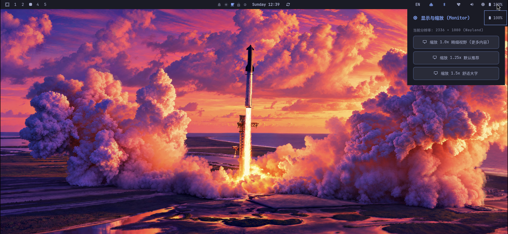

# Omarchy Android

在 Android 手机、折叠屏与平板上运行 Omarchy 风格的 Ubuntu ARM64 Wayland 桌面。桌面核心、免 Root 一体 App 和 Root chroot 运行时在同一个仓库开发与维护。

## 选择使用方式

| 正式路线 | 项目位置 | 使用方式与状态 |
| --- | --- | --- |
| 免 Root 一体 App | [`apps/android/`](apps/android/) | APK 集成 PRoot、X11 与桌面入口，无需额外安装 Termux；新流程在首次运行时选择、下载或离线导入桌面镜像 |
| Root chroot | [`install.sh`](install.sh)、[`runtime/chroot/`](runtime/chroot/) | 为已有 Root 环境提供冷安装（`/data/omarchy-chroot`）与桌面启动，已在 K20 Pro 完成集成与输入验收 |

外部 Termux + Termux:X11 的免 Root PRoot 路线保留为开发、调试和迁移入口。可选的 [Omarchy Deck](apps/deck/) 为外部 X11 提供悬浮输入工具，不是第三条正式产品路线。一体 App 包名为 `com.omarchy.android`，Deck 包名为 `com.omarchy.deck`。

## 实机效果




## 桌面功能

- Sway 平铺窗口管理、Waybar 顶栏、GtkLayerShell 状态弹窗与 6 列原生应用网格。
- Omarchy 主题与壁纸，联动 Sway、Waybar、Wofi、App Grid 和 Alacritty 配色。
- Fcitx5 中文拼音、Android 输入法穿透、悬浮键盘与横竖屏控制。
- Alacritty、Thunar、Neovim、Lazygit、imv、Zathura、mpv；免 Root 初装镜像包含配套 Chromium 128，保留轻量 WebKitGTK 浏览器。
- 按需安装 CC Switch、Codex / ChatGPT Desktop、Claude Desktop、Hermes Desktop 等 AI 工具。
- Root 路线提供 `evdev` 外接键盘与触控板独占，支持 `Alt` / `Super` 桌面快捷键。

共享桌面逻辑放在 `core/`；两种部署路线各自维护运行时，详细区别见[架构说明](docs/ARCHITECTURE.md)。

## 快速开始

### 免 Root 一体 App

从 [v1.0.79-test](https://github.com/Audrey-cn/omarchy-android/releases/tag/v1.0.79-test) 安装约 33.8 MB 的 `arm64-v8a` 精简 APK。本轮在 K20 Pro 验证了从 72 的同签名覆盖安装，详细结果见[实机记录](docs/reports/update-maintenance-k20-20261124.md)。

新用户可在首次安装页面刷新[公开镜像目录](https://github.com/Audrey-cn/omarchy-android/releases/tag/desktop-images)，选择[本轮干净初装镜像](https://github.com/Audrey-cn/omarchy-android/releases/tag/desktop-ubuntu24-91a120142609)。App 提供持久断点、暂停后继续和匹配镜像的离线导入，安装包包含 Android 界面、内嵌 X11 与 PRoot。K20 已验证该镜像的离线导入与桌面启动；历史在线续传也有独立记录。操作见[首次安装与更新](docs/initial-install.md)。

后续 App、X11 和 PRoot 更新沿用同一持久签名密钥，通过 Android 覆盖安装保留现有桌面与个人数据；日常启动不再同步 guest 文件或重新导入镜像。Ubuntu 软件包继续使用现有 APT 软件源维护。桌面菜单「更新」按来源展示 Ubuntu、APK、项目桌面、图形、浏览器配套和第三方应用的检查结果。项目组件由用户显式安装及恢复。本轮发布[桌面组件 1.0.3](https://github.com/Audrey-cn/omarchy-android/releases/tag/desktop-v1.0.3)和[运行时 1.0.0](https://github.com/Audrey-cn/omarchy-android/releases/tag/runtime-v1.0.0)。操作与实测范围见[组件更新说明](docs/component-updates.md)和[交付记录](docs/reports/update-maintenance-k20-20261124.md)。初装镜像低频汇总修正后供新安装选择，已有桌面无需跟随每次镜像重发。

### Root chroot

Root 路线提供干净镜像安装入口，要求 ARM64 Android、Root、支持挂载命名空间的 BusyBox，以及 Termux/X11 配套。安装到新目录 `/data/omarchy-chroot`，支持下载固定公开镜像或导入匹配的本地文件，发现目标已存在会拒绝覆盖。入口为 `./install.sh --mode chroot`；具体前置条件与选项见[首次安装与更新](docs/initial-install.md)。

### 开发与迁移：外部 Termux

免 Root 分体部署可在已安装 Termux 和 Termux:X11 的设备上运行：

```bash
git clone https://github.com/Audrey-cn/omarchy-android.git
cd omarchy-android
./install.sh --mode proot

# 安装时同时加入 AI 桌面工具
./install.sh --mode proot --with-ai
```

这一路径用于开发、调试和迁移；Deck 可辅助输入，不能代替 Termux 或 Termux:X11。

### 常用快捷键

| 快捷键 | 功能 |
| --- | --- |
| `Super + Space` | 打开应用网格 |
| `Super + Enter` | 打开终端 |
| `Super + W` | 关闭当前窗口 |
| `Super + 1~5` | 切换工作区 |
| `Super + K` | 打开快捷键速查表 |

Termux 路线还提供 `Alt` 组合键；快捷键以当前 Sway 配置与桌面速查表为准。

## 目录结构

```text
omarchy-android/
├── core/                     # 共享桌面脚本、AI 启动封装、Sway/Fcitx5 配置
├── runtime/
│   ├── chroot/               # 外部 Termux + Root chroot 运行时
│   └── proot/                # 外部 Termux + proot-distro 运行时
├── apps/
│   ├── android/              # 免 Root 一体包：Gradle 工程、容器配置、原生库
│   └── deck/                 # 外部 Termux:X11 使用的辅助 APK
├── install.sh                # Root 集成与外部 Termux 开发部署入口
├── scripts/
│   ├── stage-core.sh         # 将本次 checkout 的 core 安装到指定 rootfs
│   └── backup-personal.sh    # 个人配置迁移脚本，生成的备份不入库
├── .github/workflows/        # 精简 App、独立初装镜像与 Deck 构建
└── docs/
    ├── ARCHITECTURE.md        # 两种运行栈与共享核心
    └── DEVELOPMENT.md         # 开发、构建与迁移说明
```

初装镜像从本仓库的 `core/` 构建，并记录来源提交、配套组件及校验信息。镜像构建与频繁的 App 构建独立；镜像 Release 不占用 App 的 latest 发布入口。桌面和 Android 界面的修改仍可放在同一个提交中。

## 开发与维护

开发命令、云端工作流、镜像放置位置及 Git 历史迁移方式见[开发指南](docs/DEVELOPMENT.md)，六大维护通道与发版规范见[维护总览手册](docs/MAINTENANCE.md)，已有进度见[交接记录](docs/HANDOFF.md)，APK 保留与历史发行版见[版本与备份](docs/VERSIONS.md)。原独立 App 仓库已合并入本仓并清理删除，后续所有开发与发布统一在本仓库进行。

## 个人配置

个人换机迁移可使用 `scripts/backup-personal.sh`。API Key、Token、账号数据库及个人备份不应提交到仓库；生成的个人备份已加入忽略规则。

## 许可证与致谢

共享核心、Termux 运行时与 Deck 沿用根目录的 [MIT License](LICENSE)。`apps/android/` 基于 [Tiny Container](https://github.com/Cateners/tiny_container)，沿用其 [GPL-3.0 许可及文件声明](apps/android/COPYING)。第三方库、主题、字体和工具保留各自许可，详见[许可证说明](LICENSES.md)。

感谢 [Omarchy](https://github.com/basecamp/omarchy)、[Tiny Container](https://github.com/Cateners/tiny_container)、[Termux:X11](https://github.com/termux/termux-x11)、[PRoot](https://github.com/proot-me/proot)、Sway、wlroots 及相关开源项目。
