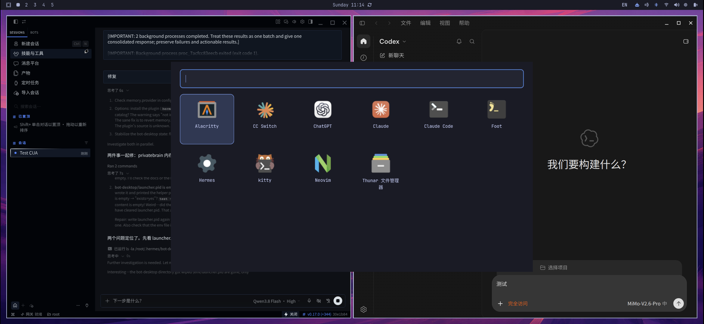

# Omarchy Android

在 Android 手机、折叠屏与平板上运行 Omarchy 风格的 Ubuntu ARM64 Wayland 桌面。桌面核心、免 Root 一体 App 和 Root chroot 运行时在同一个仓库开发与维护。

## 选择使用方式

| 正式路线 | 项目位置 | 使用方式与状态 |
| --- | --- | --- |
| 免 Root 一体 App | [`apps/android/`](apps/android/) | APK 集成 PRoot、X11 与桌面入口，无需额外安装 Termux；新流程在首次运行时选择、下载或离线导入桌面镜像 |
| Root chroot | [`install.sh`](install.sh)、[`runtime/chroot/`](runtime/chroot/) | 为已有 Root 环境提供 chroot 运行时；完整冷安装与云端镜像、实机集成仍待完成 |

外部 Termux + Termux:X11 的免 Root PRoot 路线保留为开发、调试和迁移入口。可选的 [Omarchy Deck](apps/deck/) 为外部 X11 提供悬浮输入工具，不是第三条正式产品路线。一体 App 包名为 `com.omarchy.android`，Deck 包名为 `com.omarchy.deck`。

## 实机效果




## 桌面功能

- Sway 平铺窗口管理、Waybar 顶栏、GtkLayerShell 状态弹窗与 6 列原生应用网格。
- Omarchy 主题与壁纸，联动 Sway、Waybar、Wofi、App Grid 和 Alacritty 配色。
- Fcitx5 中文拼音、Android 输入法穿透、悬浮键盘与横竖屏控制。
- Alacritty、Thunar、Neovim、Lazygit、imv、Zathura、mpv；免 Root 初装镜像包含配套 Chromium 128，保留轻量 WebKitGTK 浏览器。
- 按需安装 CC Switch、Codex / ChatGPT Desktop、Claude Desktop、Hermes Desktop 等 AI 工具。
- Root 路线提供 `evdev` 外接键盘与触控板独占，支持 `Alt` / `Super` 桌面快捷键。

共享桌面逻辑放在 `core/`；两种部署路线各自维护运行时，详细区别见[架构说明](docs/ARCHITECTURE.md)。

## 快速开始

### 免 Root 一体 App

使用已通过 K20 Pro 验证的 [v1.0.72-test](https://github.com/Audrey-cn/omarchy-android/releases/tag/v1.0.72-test) 精简 APK，约 33.7 MB，仅支持 `arm64-v8a`；下载以主仓库 [Releases](https://github.com/Audrey-cn/omarchy-android/releases) 的实际附件为准。已验证从 `v1.0.62-test` 同签名覆盖升级、既有数据保留和真实 Hermes Agent 回归，详见[本轮实机记录](docs/reports/online-installer-k20-20261123.md)。

精简 APK 提供首次安装页面：选择初始镜像 → 下载并安装，支持持久断点、暂停后继续和匹配镜像的离线导入。APK 保留 Android 界面、内嵌 X11 与 PRoot，桌面及浏览器内容随初装镜像分发。首个[干净初装镜像](https://github.com/Audrey-cn/omarchy-android/releases/tag/desktop-ubuntu24-e55030353df6)和[镜像目录](https://github.com/Audrey-cn/omarchy-android/releases/tag/desktop-images)已公开，支持 App 版本代码 64 及以上，随包目录也已加入同一镜像。K20 已完成下载恢复、完整镜像校验安装、离线导入和桌面启动验收；测试条件见[实机记录](docs/reports/online-installer-k20-20261123.md)，操作说明见[首次安装与更新](docs/initial-install.md)。

后续 App、X11 和 PRoot 更新沿用同一持久签名密钥，通过 Android 覆盖安装保留现有桌面与个人数据；日常启动不再同步 guest 文件或重新导入镜像。Ubuntu 软件包继续使用现有 APT 软件源维护。下一轮将补齐用户显式发起的项目桌面组件更新，负责脚本、界面及适配，当前尚未交付；职责、缺口和验收要求见[更新维护清单](docs/discussions/2026-11-23-update-maintenance.md)。初装镜像低频汇总修正后供新安装选择，已有桌面无需跟随每次镜像重发。

### Root chroot

Root 路线目前提供运行时和桌面部署脚本，依赖已有可用 Ubuntu 环境、Root 和外部 Termux/X11 配套；从零下载、导入系统的完整安装流程尚未交付。具备这些前提的开发环境可从 [`install.sh`](install.sh) 的 `--mode chroot` 入口继续集成，部署现状见[发行与 Root 记录](docs/discussions/2026-11-23-distribution-and-root.md)。

### 开发与迁移：外部 Termux

免 Root 分体部署可在已安装 Termux 和 Termux:X11 的设备上运行：

```bash
git clone https://github.com/Audrey-cn/omarchy-android.git
cd omarchy-android
./install.sh --mode proot

# 安装时同时加入 AI 桌面工具
./install.sh --mode proot --with-ai
```

这一路径用于开发、调试和迁移；Deck 可辅助输入，不能代替 Termux 或 Termux:X11。

### 常用快捷键

| 快捷键 | 功能 |
| --- | --- |
| `Super + Space` | 打开应用网格 |
| `Super + Enter` | 打开终端 |
| `Super + W` | 关闭当前窗口 |
| `Super + 1~5` | 切换工作区 |
| `Super + K` | 打开快捷键速查表 |

Termux 路线还提供 `Alt` 组合键；快捷键以当前 Sway 配置与桌面速查表为准。

## 目录结构

```text
omarchy-android/
├── core/                     # 共享桌面脚本、AI 启动封装、Sway/Fcitx5 配置
├── runtime/
│   ├── chroot/               # 外部 Termux + Root chroot 运行时
│   └── proot/                # 外部 Termux + proot-distro 运行时
├── apps/
│   ├── android/              # 免 Root 一体包：Gradle 工程、容器配置、原生库
│   └── deck/                 # 外部 Termux:X11 使用的辅助 APK
├── install.sh                # Root 集成与外部 Termux 开发部署入口
├── scripts/
│   ├── stage-core.sh         # 将本次 checkout 的 core 安装到指定 rootfs
│   └── backup-personal.sh    # 个人配置迁移脚本，生成的备份不入库
├── .github/workflows/        # 精简 App、独立初装镜像与 Deck 构建
└── docs/
    ├── ARCHITECTURE.md        # 两种运行栈与共享核心
    └── DEVELOPMENT.md         # 开发、构建与迁移说明
```

初装镜像从本仓库的 `core/` 构建，并记录来源提交、配套组件及校验信息。镜像构建与频繁的 App 构建独立；镜像 Release 不占用 App 的 latest 发布入口。桌面和 Android 界面的修改仍可放在同一个提交中。

## 开发与维护

开发命令、云端工作流、镜像放置位置及 Git 历史迁移方式见[开发指南](docs/DEVELOPMENT.md)，已有进度见[交接记录](docs/HANDOFF.md)，APK 保留与历史发行版见[版本与备份](docs/VERSIONS.md)。原 App 的源码和历史已导入本仓，后续开发统一在本仓库进行，不依赖旁边的旧目录；旧远端尚未归档。

## 个人配置

个人换机迁移可使用 `scripts/backup-personal.sh`。API Key、Token、账号数据库及个人备份不应提交到仓库；生成的个人备份已加入忽略规则。

## 许可证与致谢

共享核心、Termux 运行时与 Deck 沿用根目录的 [MIT License](LICENSE)。`apps/android/` 基于 [Tiny Container](https://github.com/Cateners/tiny_container)，沿用其 [GPL-3.0 许可及文件声明](apps/android/COPYING)。第三方库、主题、字体和工具保留各自许可，详见[许可证说明](LICENSES.md)。

感谢 [Omarchy](https://github.com/basecamp/omarchy)、[Tiny Container](https://github.com/Cateners/tiny_container)、[Termux:X11](https://github.com/termux/termux-x11)、[PRoot](https://github.com/proot-me/proot)、Sway、wlroots 及相关开源项目。
