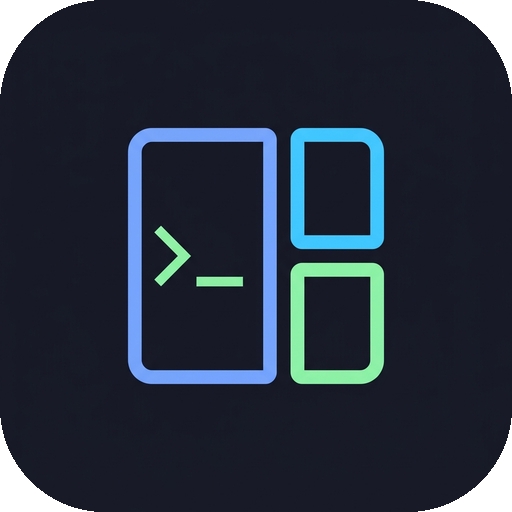
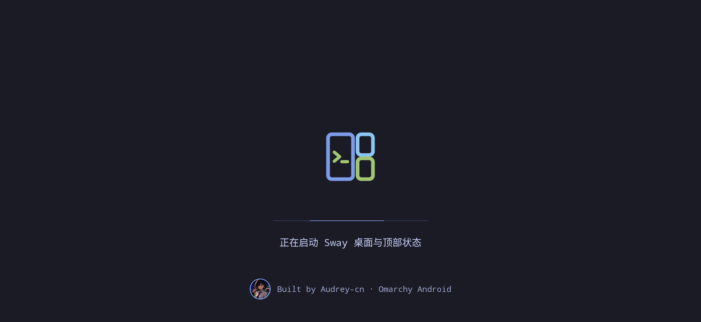
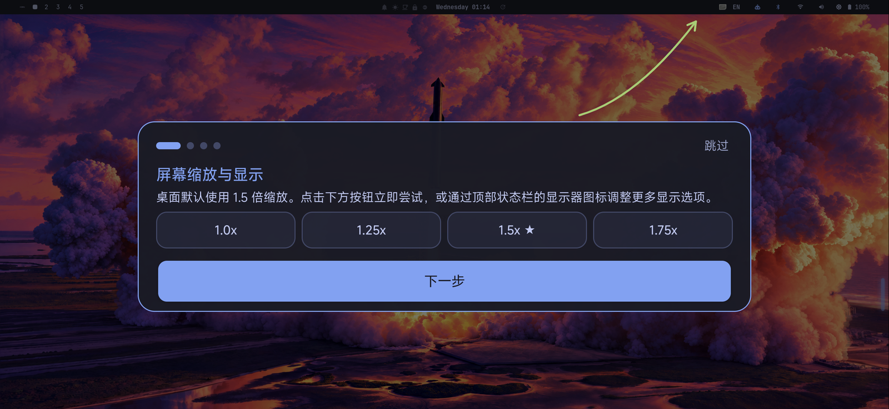
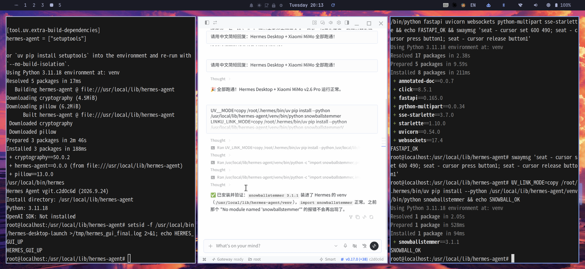
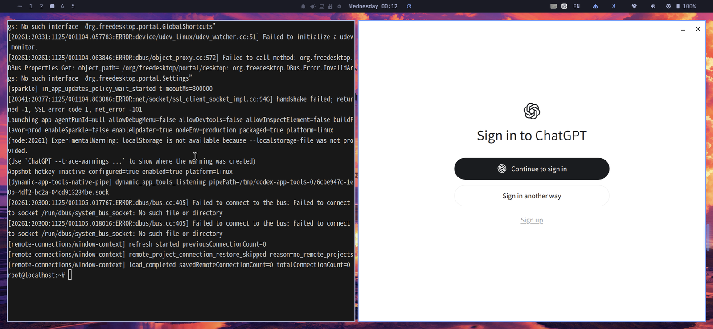

<div align="center">
  
  <h1>Omarchy Android</h1>
  <p><strong>Your phone. A real, opinionated Linux &amp; AI workstation.</strong></p>
  <p>An Omarchy-inspired Ubuntu 24.04 ARM64 + Sway Wayland desktop, engineered from the ground up for Android touchscreens, keyboards, and native ARM64 AI workflows — <strong>no root required</strong>.</p>
  <p>
    <a href="https://github.com/Audrey-cn/omarchy-android/releases"></a>
    <a href="apps/android/COPYING"></a>
    
    
    <a href="https://github.com/Audrey-cn/omarchy-android/forks"></a>
    <a href="https://github.com/Audrey-cn/omarchy-android/issues"></a>
  </p>
  <p><strong>English</strong> | <a href="README.zh-CN.md"><strong>简体中文</strong></a></p>
  <p><a href="https://github.com/Audrey-cn/omarchy-android/releases"><strong>Download Latest APK</strong></a> · <a href="docs/initial-install.md">Installation Guide</a> · <a href="docs/ARCHITECTURE.md">Architecture</a> · <a href="CONTRIBUTING.md">Contribute</a></p>
</div>

---

## Real-Device Showcase

Every screenshot below was captured directly on real Android phones (Redmi K90 Pro Max · **Android 17 Rootless** & Redmi K20 Pro · **Android ARM64**).

| Tokyo Night Breathing Splash &amp; Attribution | 4-Step Interactive High-DPI Onboarding |
| :---: | :---: |
|  |  |
| **Bottom Dock (`Super + D`) &amp; Live Update Progress** | **Hermes Desktop + Local AI Tool Calling** |
|  |  |
| **Native ARM64 VS Code (Wayland)** | **Native ARM64 Codex / ChatGPT Desktop** |
|  |  |
| **Firefox + `ffmpeg` HTML5 Video &amp; Danmaku** | **Transparent Floating Keyboard &amp; Edge Handle** |
|  |  |

---

## What Makes Omarchy Android Different?

Most "Linux on Android" setups stop at giving you a raw VNC window or a bare terminal. **Omarchy Android** sweats the last mile of mobile ergonomics, PRoot reliability, and native ARM64 AI tooling:

### 1. Mobile-Native Desktop Ergonomics (Not Just a Shrunk PC)
- **Zero-permission edge handle &amp; redesigned floating OSK:** Runs in-process inside the display activity — **no `SYSTEM_ALERT_WINDOW` overlay permission required**. Tap to expand controls, double-tap for the redesigned dual-mode floating keyboard (compact bar + layered symbol pages, long-press key repeat for BackSpace/arrows, thin opacity slider &amp; drag pill), long-press for Android IME/voice input, or drag to either screen edge.
- **Universal WebKitGTK / Tauri paste &amp; smart-focus:** Automatically detects any WebKitGTK/Tauri window via `/proc/<pid>/maps` for reliable direct-type paste (including CC Switch), restarts `deck-bridge` automatically after desktop updates, and matches Omarchy smart-focus window titles cleanly.
- **Tokyo Night Bottom Dock (`Super + D`):** A solid rounded GTK Layer-Shell dock with crisp JetBrainsMono Nerd Font icons and live active-window pills — accessible from both keyboard and touch.
- **4-step interactive onboarding &amp; R-corner safe margins:** Curved guide arrows walk you through `1.5×` high-DPI live scaling, edge handle gestures, `Super + K` shortcuts, and input permissions. Configurable screen-corner padding keeps Waybar away from rounded phone bezels.
- **Hard-locked orientation &amp; portrait keyboard viewport:** Lock Portrait or Landscape cleanly; in Portrait mode, the desktop viewport automatically shrinks above Android's soft keyboard so your terminal prompt is never covered.

### 2. Thoughtful Startup, Background Residency &amp; Graceful Shutdown
- **Zero-black-screen polish:** Cold starts present a Tokyo Night breathing splash with staged progress (`Linux container` → `Graphics display` → `Sway desktop & top bar`) and an offline-bundled circular author badge (`Built by Audrey-cn · Omarchy Android`). Warm foreground resumes use a **300 ms delay threshold** — fast returns are completely flash-free, while slower surface restores surface a subtle translucent resume pill.
- **Single unified notification &amp; one-tap "Stop Desktop":** Upstream `Termux:X11`'s redundant notification is automatically suppressed, leaving one clean **Omarchy Desktop** card with a native **Stop Desktop** action (plus a confirmed **Close Desktop** button inside the in-desktop control panel).
- **Graceful shutdown that protects your data:** Stopping the desktop sends `SIGTERM` to flush PRoot/SQLite databases cleanly before tearing down `:xserver` and releasing battery/RAM — never leaving zombie processes behind.

### 3. Native ARM64 AI &amp; Developer Workstation (Battle-Tested)
Install official upstream ARM64 desktop apps straight from **Install → AI / Editor**, with automatic PRoot &amp; Wayland hardening built in:
- **Hermes Desktop + Local Hermes Agent:** Pinned official ARM64 package with SHA-256 verification, fingerprinted first-run timeout repair (with rollback receipt), local `node-pty` rebuild for Ubuntu 24.04, global `UV_LINK_MODE=copy` (eliminating PRoot hardlink corruption), and an automatic pre-launch venv self-healer (`omarchy-ensure-hermes-venv`) covering both `~/.hermes` and `/usr/local/lib/hermes-agent`.
- **Claude Desktop + CC Switch:** Official Anthropic ARM64 APT repository with `--no-install-recommends` (preventing 1.5 GB bloat and `systemd-resolved` DNS breakage), single-repo 1-second metadata refresh, and automatic **3P Gateway** (`--user-data-dir=/root/.config/Claude-3p`) detection in `claude-desktop-launch`.
- **Codex / ChatGPT Desktop, VS Code &amp; Helix:** Official ARM64 native builds with Wayland IME &amp; PRoot launcher flags ready out of the box.
- **Universal App Grid deduplication &amp; self-healing native icons:** `omarchy-app-grid` deduplicates raw vendor `.desktop` entries with strict `Exec=/TryExec=` basename matching (so VS Code never inherits another app's icon), while `omarchy-fix-desktops` + `librsvg2-common` self-heal stale managed launcher icons (including the official Hermes PNG icon) so every app shows **one crisp native icon**.
- **Verified HTTPS proxy auto-detection:** `omarchy-installer.sh` probes common local proxy ports (`18888 / 7890 / 7897 / 10809 / 10808`) with a live HTTPS handshake check — accelerating downloads when a working proxy is active and silently falling back to direct connections if a port is sleeping or SOCKS-only.

### 4. Resilient Global &amp; China-Friendly Distribution
- **Guided Download Route in both APK &amp; Desktop Update Center:** Switch between **GitHub Direct**, **China Mirror**, or a **Custom Mirror** right on the setup screen or inside the 2-path GTK Update Center (**Omarchy Desktop** + **Linux APT**).
- **Same-source HTTP `Range` retry, Atom fallback &amp; SHA-256 verification:** Transient mid-stream LTE drops retry up to 2× on the same mirror without losing downloaded progress; GitHub API `403`/`429` rate limits automatically fall back to the Releases Atom feed &amp; web redirect; any size or SHA-256 mismatch falls back to official GitHub releases.
- **Live terminal progress &amp; instant rollback:** Desktop component updates stream real-time progress bars, transfer speed, and ETA, with one-click recovery (`omarchy-component-update recover`) to the previous generation.
- **PRoot HTML5 video &amp; audio solved:** Bundles PRoot-safe **Mozilla Firefox** + `ffmpeg` (`MOZ_SHM_NO_SEALS=1`, `media.cubeb.sandbox=false`) for smooth HTML5 video and danmaku playback (verified on Bilibili), paired with PulseAudio (`omarchy_out`) audio bridging and `fcitx5` Chinese Pinyin IME.

---

## Quick Start — 30-Second Setup

You need an **ARM64 Android device** with ~4.5 GB free storage for the download cache and extracted Ubuntu 24.04 desktop.

| Step | What to do |
| :--- | :--- |
| **1 · Install APK** | Download `OmarchyAndroid-v1.0.3-arm64.apk` from [Releases](https://github.com/Audrey-cn/omarchy-android/releases) and open **Omarchy Android**. |
| **2 · Fetch Ubuntu 24.04** | Pick your download route (**GitHub Direct** or **China Mirror**) and tap **Download and install desktop**. Supports pause/resume and offline `rootfs.tar.zst` import. |
| **3 · Launch Desktop** | Tap **Launch desktop**, walk through (or skip) the 4-step guide, and press `Super + Space` for the App Grid or `Super + D` for the Bottom Dock. |

[Full installation &amp; update guide](docs/initial-install.md) · [Published image catalog](https://github.com/Audrey-cn/omarchy-android/releases/tag/desktop-images)

### Edge-Handle Gestures &amp; Core Shortcuts

| Edge Handle Gesture | Action | Core Shortcut (`Super` or `Alt`) | Action |
| :--- | :--- | :--- | :--- |
| **Tap** | Expand floating control panel (keyboard, IME, orientation, settings, Stop Desktop) | `Super + Space` | Open App Grid |
| **Double-tap** | Toggle transparent `0.70×` floating keyboard | `Super + D` | Toggle Tokyo Night Bottom Dock |
| **Long-press (350 ms)** | Open Android IME / voice input with haptic feedback | `Super + Enter` | Open Alacritty terminal |
| **Drag** | Reposition vertically &amp; snap to left/right edge | `Super + W` | Close focused window |
| | | `Super + 1` … `5` | Switch workspaces |
| | | `Super + K` / `Super + Alt + Space` | Shortcut guide / Omarchy menu |

---

## Real-Device Verification Matrix

| Device | OS &amp; Mode | Resolution | Verified Highlights |
| :--- | :--- | :--- | :--- |
| **Redmi K90 Pro Max** | **Android 17 (SDK 37) · Rootless** | `2608 × 1200` (480 dpi) | Fresh `da2da65` image download (`5.52 MB/s`), `v1.0.2` breathing splash + circular avatar, single unified notification + Stop Desktop, `1.5×` onboarding, Bottom Dock, `fcitx5` Pinyin, Wayland clipboard, PulseAudio, Update Center (`desktop-v1.0.19`), Firefox Bilibili HTML5 playback |
| **Redmi K20 Pro** | **Android ARM64 · Rooted** | `2340 × 1080` | Full clean-slate install, LTE mirror failover, APK in-place upgrade with 100% data retention, Update Center `recover` + re-upgrade, **Hermes Desktop** (MiMo + local terminal tool calling), **Claude Desktop + CC Switch** (3P Gateway + MiMo), **Codex / ChatGPT Desktop**, **VS Code**, **Helix** |

---

## Pinned Baselines &amp; Optional Root Route

| Component | Baseline | Update Channel |
| :--- | :--- | :--- |
| **Android App (APK)** | **v1.0.3** (`versionCode 103`) | Same-signature APK updates preserve your Ubuntu guest and personal data. |
| **Desktop Components** | **desktop-v1.0.27** | Updated explicitly from the in-desktop Update Center with rollback support. |
| **Chromium / Playwright** | **128.0.6613.18** | Pinned for verified PRoot compatibility; Mozilla Firefox DEB + `ffmpeg` preinstalled for everyday media/web. |
| **Hermes Desktop** | **2026.9.7-7** | Reviewed upstream ARM64 build with fingerprinted onboarding, PTY, and venv repairs. |
| **Ubuntu Base** | **24.04 LTS ARM64** | Standard `apt` updates inside the guest. |

For rooted devices wanting a separate **Root chroot** runtime (external Termux:X11 + hardware input), see [docs/root-chroot.md](docs/root-chroot.md):

```bash
git clone https://github.com/Audrey-cn/omarchy-android.git
cd omarchy-android
./install.sh --mode chroot --inspect
./install.sh --mode chroot
```

---

## Explore, Fork &amp; Contribute

| Area | Path |
| :--- | :--- |
| Shared desktop scripts, Dock, App Grid, themes &amp; AI launchers | [`core/`](core/) |
| Android app, installer, breathing splash, shutdown &amp; floating controls | [`apps/android/`](apps/android/) |
| Root chroot &amp; legacy Termux PRoot runtimes | [`runtime/`](runtime/) |
| Maintenance, release channels &amp; recovery handbook | [docs/MAINTENANCE.md](docs/MAINTENANCE.md) |
| Development &amp; build guide | [docs/DEVELOPMENT.md](docs/DEVELOPMENT.md) |
| Contributing &amp; PR checks | [CONTRIBUTING.md](CONTRIBUTING.md) |

---

## License &amp; Acknowledgments

The Android application is based on **[Tiny Container](https://github.com/Cateners/tiny_container)** by Caten Hu and retains **GPL-3.0-or-later** and its original notices; see [COPYING](apps/android/COPYING). The shared desktop core, Termux runtimes, Deck and original repository documentation retain the root [MIT license](LICENSE). Third-party code, themes, fonts and tools retain their own licenses; see [LICENSES.md](LICENSES.md).

Thank you to [Omarchy](https://github.com/basecamp/omarchy), [Tiny Container](https://github.com/Cateners/tiny_container), [Termux:X11](https://github.com/termux/termux-x11), [PRoot](https://github.com/proot-me/proot), [Sway](https://github.com/swaywm/sway), [wlroots](https://gitlab.freedesktop.org/wlroots/wlroots), and their contributors.

## Support

Maintained by [Audrey](https://github.com/Audrey-cn/omarchy-android). If this project helps you, consider supporting development via [GitHub Sponsors](https://github.com/sponsors/Audrey-cn), or share a device report, translation, or PR.
