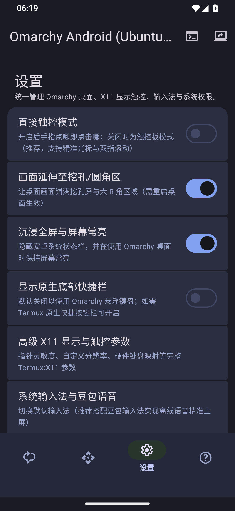
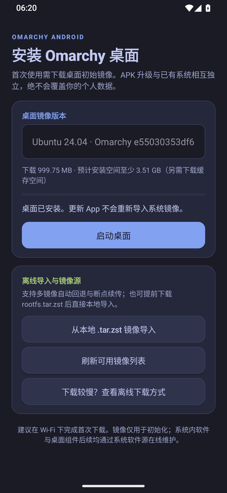

<div align="center">
  
  <h1>Omarchy Android</h1>
  <p><strong>Your phone. A real Linux desktop.</strong></p>
  <p>An Omarchy-inspired Ubuntu ARM64 desktop, built for Android touch, keyboards and everyday tinkering.</p>
  <p>
    <a href="https://github.com/Audrey-cn/omarchy-android/releases"></a>
    <a href="apps/android/COPYING"></a>
    
    
    <a href="https://github.com/Audrey-cn/omarchy-android/forks"></a>
    <a href="https://github.com/Audrey-cn/omarchy-android/issues"></a>
  </p>
  <p><strong>English</strong> | <a href="README.zh-CN.md"><strong>简体中文</strong></a></p>
  <p><a href="https://github.com/Audrey-cn/omarchy-android/releases"><strong>Download APK</strong></a> · <a href="docs/initial-install.md">Installation guide</a> · <a href="CONTRIBUTING.md">Contribute</a></p>
</div>

## Real-device showcase

| Sway desktop & edge dock | Transparent floating keyboard |
| --- | --- |
|  |  |
| **One place for your controls** | **Choose, download or import your desktop** |
|  |  |

## Why Omarchy Android?

- **Rootless by default.** Install the Android app and set up Ubuntu inside it. X11 and PRoot are included; no separate Termux installation is needed. An optional **Root chroot** route is available for rooted devices.
- **A real Wayland session.** Sway, Waybar, a native app grid, themes and Linux applications run inside Ubuntu 24.04 ARM64. Sway uses an X11 backend to display through Android's embedded X server.
- **One gesture away.** An edge handle opens Android input, toggles a transparent floating keyboard, or reveals orientation and settings controls. Move it to either edge at a comfortable height.
- **Made for touch and keyboards.** Android IME bridging, Chinese input, adjustable scaling and Super/Alt shortcuts make a phone, foldable or tablet usable as a desktop.
- **Updates at their own pace.** APK, desktop components, graphics/browser runtimes and the initial image have separate release channels. Compatible, same-signature APK updates preserve the existing guest; Ubuntu packages use APT and guest components update explicitly from the desktop.

Start with Alacritty, Thunar, Neovim, Lazygit, imv, Zathura, mpv and Chromium. Add CC Switch, Codex / ChatGPT Desktop, Claude Desktop or Hermes Desktop from the installer as needed. See the [architecture](docs/ARCHITECTURE.md) for both runtime routes.

## Quick start — the 30-second overview

You need an **ARM64 Android device** and enough free space for the download, extracted desktop and the installer's stated reserve. Download and extraction time depend on your connection and device.

| Step | What to do |
| --- | --- |
| **1 · Install** | Download the `arm64-v8a` APK from [Releases](https://github.com/Audrey-cn/omarchy-android/releases) and open Omarchy Android. |
| **2 · Set up Ubuntu** | Select a compatible image and choose **Download and install desktop**. Downloads support pause/resume. For offline setup, select the matching image, then import its original `rootfs.tar.zst`. |
| **3 · Launch** | Tap **Launch desktop** and follow the skippable four-step guide. Open the app grid with `Super + Space`. |

[Full installation and update guide](docs/initial-install.md) · [Published image catalog](https://github.com/Audrey-cn/omarchy-android/releases/tag/desktop-images)

### Four edge-handle gestures

| Gesture on the handle | Action |
| --- | --- |
| **Swipe inward** | Open Android IME input; use Doubao IME for Chinese and voice input. |
| **Double-tap** | Show or hide the transparent floating keyboard. |
| **Tap** | Expand the dock for keyboard, input, orientation lock and unified settings. |
| **Drag** | Reposition vertically and snap to the left or right edge. |

### Six core shortcuts

| Shortcut | Action |
| --- | --- |
| `Super + Space` | Open the app grid |
| `Super + Enter` | Open Alacritty terminal |
| `Super + W` | Close the focused window |
| `Super + 1` … `5` | Switch workspaces |
| `Super + K` | Open the complete shortcut guide |
| `Super + Alt + Space` | Open the Omarchy menu |

**Super / Alt dual modifiers:** the rootless desktop uses dual modifiers by default, so the first five shortcuts also work with `Alt` in place of `Super`. The keyboard settings offer Super-only and Alt-only modes; the menu chord above uses both modifiers. `Super` is usually the Windows/Command key. Check `Super + K` for your active configuration.

### Five tips for a smoother start

1. **Use Wi-Fi for the first image.** If downloading on the phone is slow, copy the matching original `rootfs.tar.zst` from another device and use offline import. The installer checks its size and SHA-256.
2. **Try an external keyboard and Doubao IME.** Bluetooth or USB makes terminal work easier. If Android intercepts a Super shortcut, use the supported Alt mode. Choose Doubao in Android's input method picker for Chinese/voice input.
3. **Adjust the display scale.** The desktop starts at **1.5×** scale; adjust it with the monitor icon in the top bar.
4. **Check child-process limits on Android 12+.** If the session ends with **Signal 9**, open the app's guidance and check the device's Developer Options for disabling child-process restrictions. The setting and availability vary by device.
5. **Allow background operation.** Set Omarchy Android's battery usage to **Unrestricted** (or the vendor equivalent) so battery management is less likely to stop an active desktop.

## Pinned versions & maintenance

| Component | Baseline | Update approach |
| --- | --- | --- |
| **Chromium** | **128.0.6613.18** | Pinned with its Playwright/Node bundle for tested PRoot compatibility and stability; maintained through the project runtime channel. |
| **Hermes Desktop** | **2026.9.7-7** | The installer uses a pinned, reviewed build with matching native-module and onboarding repairs. |
| **Ubuntu** | **24.04 ARM64** | Continue regular Ubuntu **APT updates** in the existing guest. |

The pins describe the compatibility baseline. Version selection, browser security-update limits, component updates and recovery are documented in the [maintenance handbook](docs/MAINTENANCE.md), [runtime guide](docs/runtime-components.md) and [third-party update guide](docs/third-party-updates.md).

APK updates and new initial images serve different purposes: use a compatible same-signature APK to update the app, and desktop update tools for the guest. A new initial image is a baseline for new installs. [Details](docs/initial-install.md).

## Optional Root chroot & development routes

For a rooted ARM64 device, the chroot installer provides a separate runtime with external Termux:X11 and hardware input support. Review the [prerequisites and installation guide](docs/root-chroot.md) before running:

```bash
git clone https://github.com/Audrey-cn/omarchy-android.git
cd omarchy-android
./install.sh --mode chroot --inspect
./install.sh --mode chroot
```

The installer targets a new `/data/omarchy-chroot` directory and refuses to overwrite an existing installation. The external Termux + Termux:X11 PRoot route (`./install.sh --mode proot`) is retained for development and migration; [Omarchy Deck](apps/deck/) is its optional input companion. See [development and build instructions](docs/DEVELOPMENT.md).

## Fork, customize & contribute

Make this desktop yours. Fork the repository, build a theme, improve an app package, adapt the runtime to a device, or explore another distribution in your own fork. Bring a focused proposal to an [issue](https://github.com/Audrey-cn/omarchy-android/issues) and send a PR when it is ready. Device reports, documentation and translations are useful contributions too.

Read [CONTRIBUTING.md](CONTRIBUTING.md) for the project map, checks and PR workflow. Device-specific results belong with their exact Android version, runtime route and tested build; existing [K20 Pro validation records](docs/reports/update-maintenance-k20-20261124.md) show the tested scope.

| Explore | Start here |
| --- | --- |
| Shared desktop scripts, themes and configuration | [`core/`](core/) |
| Android app, installer and floating controls | [`apps/android/`](apps/android/) |
| Root and external Termux runtimes | [`runtime/`](runtime/) |
| Release channels and recovery | [Maintenance handbook](docs/MAINTENANCE.md) |
| Building and testing | [Development guide](docs/DEVELOPMENT.md) |
| Personal configuration migration | [`scripts/backup-personal.sh`](scripts/backup-personal.sh) |

## License & acknowledgments

The Android application is based on **[Tiny Container](https://github.com/Cateners/tiny_container)** by Caten Hu and retains **GPL-3.0-or-later** and its original notices; see [COPYING](apps/android/COPYING). The shared desktop core, Termux runtimes, Deck and original repository documentation retain the root [MIT license](LICENSE). Third-party code, themes, fonts and tools retain their own licenses. See [LICENSES.md](LICENSES.md) for the component boundaries.

Thank you to [Omarchy](https://github.com/basecamp/omarchy) for the desktop inspiration, [Tiny Container](https://github.com/Cateners/tiny_container) for the Android container foundation, [Termux:X11](https://github.com/termux/termux-x11), [PRoot](https://github.com/proot-me/proot), [Sway](https://github.com/swaywm/sway), [wlroots](https://gitlab.freedesktop.org/wlroots/wlroots), and their contributors.
