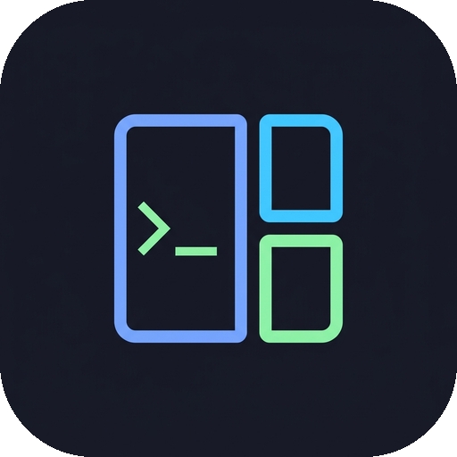
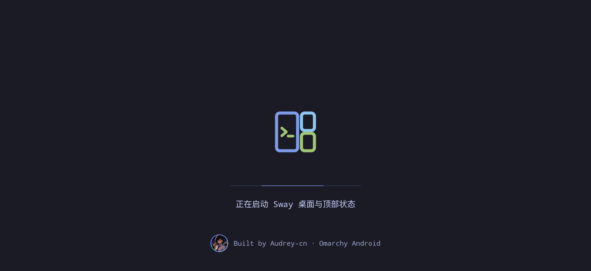
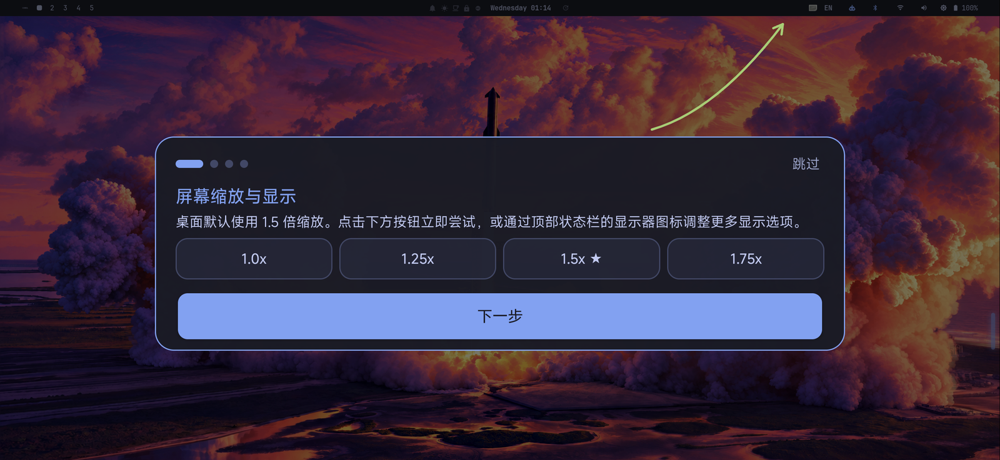
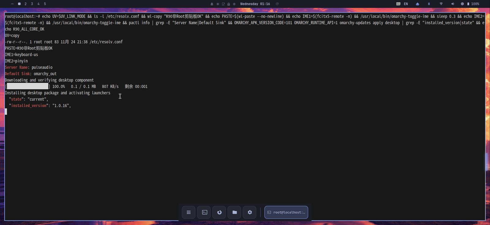
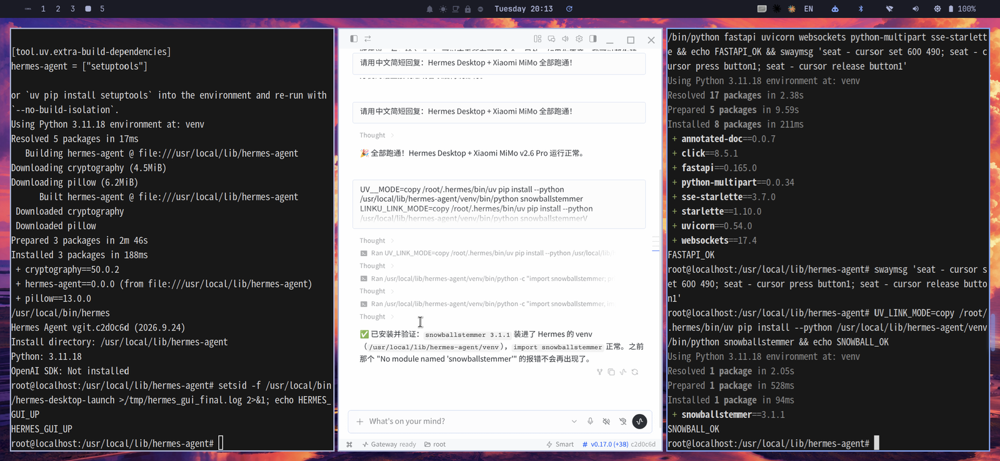
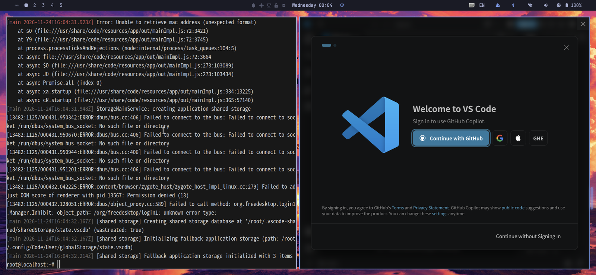
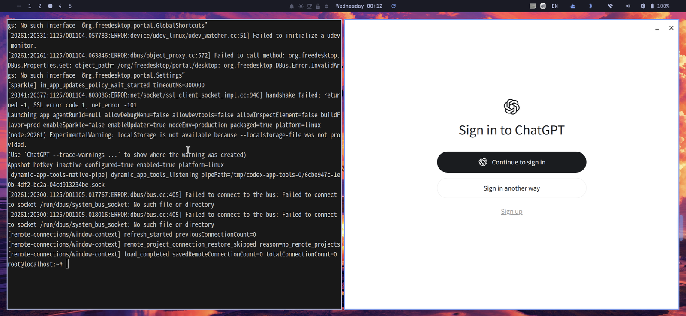
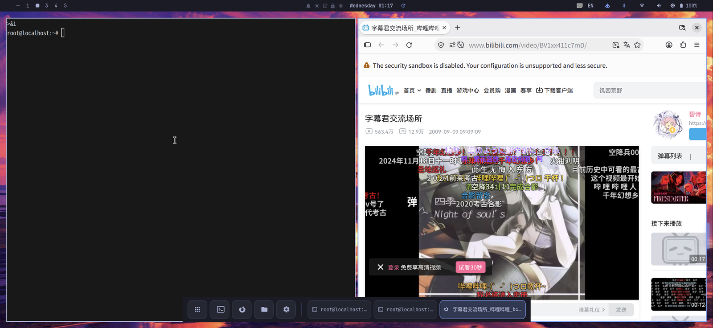
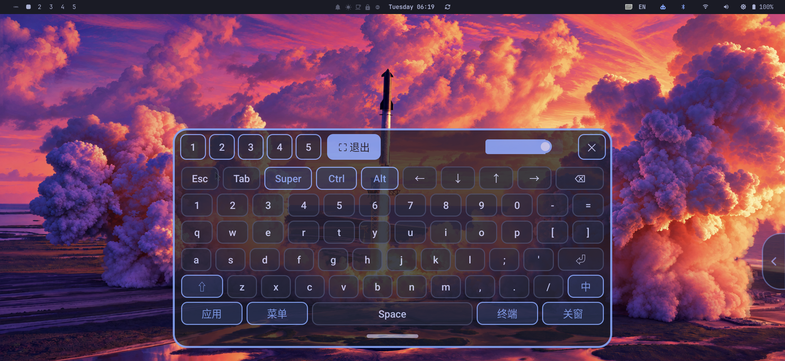

<div align="center">
  
  <h1>Omarchy Android</h1>
  <p><strong>把你的手机，变成一台真正顺手的 Linux &amp; AI 随身工作站。</strong></p>
  <p>专为 Android 触控屏、外接键盘与原生 ARM64 AI 工作流打磨的 Omarchy 风格 Ubuntu 24.04 + Sway Wayland 桌面——<strong>开箱免 Root</strong>。</p>
  <p>
    <a href="https://github.com/Audrey-cn/omarchy-android/releases"></a>
    <a href="apps/android/COPYING"></a>
    
    
    <a href="https://github.com/Audrey-cn/omarchy-android/forks"></a>
    <a href="https://github.com/Audrey-cn/omarchy-android/issues"></a>
  </p>
  <p><a href="README.md"><strong>English</strong></a> | <strong>简体中文</strong></p>
  <p><a href="https://github.com/Audrey-cn/omarchy-android/releases"><strong>下载最新 APK</strong></a> · <a href="docs/initial-install.md">安装指南</a> · <a href="docs/ARCHITECTURE.md">架构说明</a> · <a href="CONTRIBUTING.md">参与贡献</a></p>
</div>

---

## 实机展示

以下全部截图均为真机实拍（Redmi K90 Pro Max · **Android 17 纯非 Root** 与 Redmi K20 Pro · **Android ARM64**）。

| Tokyo Night 极客呼吸启动页与作者署名 | 4 步交互式高分屏实时缩放引导 |
| :---: | :---: |
|  |  |
| **底部实体 Dock (`Super + D`) 与实时进度条更新** | **Hermes Desktop + 本地终端 Tool Calling** |
|  |  |
| **微软官方 ARM64 VS Code（Wayland 原生）** | **OpenAI 原生 ARM64 Codex / ChatGPT Desktop** |
|  |  |
| **Firefox + `ffmpeg` B 站 HTML5 视频与弹幕** | **0.70× 透明悬浮键盘与贴边手柄** |
|  |  |

---

## 为什么选择 Omarchy Android？（我们的差异化巧思）

市面上大多数手机跑 Linux 的方案只停留在“勉强连上 VNC”或“黑框终端”。**Omarchy Android** 重点打磨了移动端交互体验、PRoot 疑难杂症排雷，以及全栈 ARM64 AI 桌面生态的“最后一公里”：

### 1. 为手机触控与小屏重构的桌面增强层
- **零悬浮窗权限的贴边呼吸手柄 + 重构悬浮软键盘**：进程内原生挂载，**无需申请 `SYSTEM_ALERT_WINDOW` 权限**。轻点展开控制抽屉，双击呼出全新双模式悬浮键盘（紧凑栏 + 分层符号页、退格/方向键长按连发、极细透明度滑块与底栏拖条），长按轻震直连 Android 输入法/语音输入，拖动自由吸附左右边缘。
- **WebKitGTK / Tauri 通用粘贴自动检测与智能聚焦**：通过 `/proc/<pid>/maps` 自动识别任意 WebKitGTK/Tauri 窗口（如 CC Switch）并启用直打粘贴，桌面组件更新后自动重启 `deck-bridge`，并对齐 Omarchy 智能聚焦窗口标题。
- **Tokyo Night 底部实体 Dock (`Super + D`)**：圆角实体 GTK Layer-Shell 栏，配备清晰的 JetBrainsMono Nerd Font 图标与当前活动窗口高亮胶囊，触控和键盘一样顺手。
- **4 步交互引导 + 屏幕 R 角安全边距**：曲线箭头逐步引导 `1.5×` 实时缩放、边缘手柄、`Super + K` 快捷键与输入权限；支持自定义圆角留白，彻底避免 Waybar 状态栏被手机大 R 角裁切。
- **横竖屏硬锁 + 竖屏软键盘视口自适应**：锁死横屏或竖屏不乱转；竖屏弹出系统软键盘时桌面视口自动上移收缩，终端命令行永不被遮挡。

### 2. 告别黑屏焦虑与优雅的后台生命周期
- **极客风呼吸启动页 + 300ms 热恢复防闪烁**：冷启动展示 Tokyo Night 呼吸微光图标、极细 `#7AA2F7` 流动进度条与真实阶段文案（`Linux 容器` → `图形显示服务` → `Sway 桌面与状态栏`），底部呈现离线内置的圆形蒙版 GitHub 头像与极客署名（`Built by Audrey-cn · Omarchy Android`）。热切回前台采用 **300ms 延迟阈值**——秒回无感不闪遮罩，仅在恢复较慢时轻浮现半透明恢复胶囊。
- **唯一通知栏卡片 + 一键「停止桌面」双入口**：自动屏蔽底层 `Termux:X11` 冗余通知，状态栏与下拉通知栏**只保留唯一一张「Omarchy 桌面」卡片**并内置 **`停止桌面`** 按钮；桌面内控制面板也提供带确认弹窗的 **`关闭桌面`**。
- **真正保护数据的优雅关机**：点击「停止桌面」会先发送 `SIGTERM` 让容器内进程与 SQLite 数据库（CC Switch / Hermes 等）安全落盘，再清理 `:xserver` 与前台服务，做到**既不丢数据、又彻底释放电量与内存**。

### 3. 全栈原生 ARM64 AI 与开发工作站（真机实测跑通）
从桌面 **Install → AI / Editor** 一键拉取官方原版 ARM64 软件包，自动套用深度 PRoot 适配：
- **Hermes Desktop + 本地 Hermes Agent**：严格 SHA-256 校验官方包，内置带指纹校验与回滚记录的首次引导防超时补丁、本机重编 `node-pty`、全局 `UV_LINK_MODE=copy`（根治 PRoot 硬链接损坏），以及启动前毫秒级自愈脚本 `omarchy-ensure-hermes-venv`（同时覆盖 `~/.hermes` 与 `/usr/local/lib/hermes-agent`）。
- **Claude Desktop + CC Switch**：直连 Anthropic 官方 ARM64 APT 源，使用 `--no-install-recommends` 与单源 1 秒刷新（彻底杜绝拉取 1.5 GB 冗余包及 `systemd-resolved` 破坏 `/etc/resolv.conf`），启动器自动识别 3P 网关配置（`--user-data-dir=/root/.config/Claude-3p`）配合 CC Switch 灵活路由模型。
- **Codex / ChatGPT Desktop、VS Code 与 Helix**：官方原版 ARM64 客户端，开箱自带 Wayland IME 与 PRoot 启动参数。
- **应用网格严格去重与图标自愈**：`omarchy-app-grid` 严格按 `Exec=/TryExec=` 二进制基名匹配去重（杜绝 VS Code 误继承其他应用图标），配合 `omarchy-fix-desktops` 与 `librsvg2-common` 自动自愈陈旧启动器图标并接入 Hermes 官方 PNG 图标——每个应用都只显示**唯一且清晰的原生图标**。
- **真实 HTTPS 握手验证的本地代理探测**：`omarchy-installer.sh` 自动探测常见本机代理端口（`18888 / 7890 / 7897 / 10809 / 10808`），**必须通过真实 HTTPS 握手才启用加速**，遇到休眠或纯 SOCKS 端口自动静默回退直连，永不误报 `Proxy CONNECT aborted`。

### 4. 兼顾全球与国内网络的容灾分发体系
- **APK 与桌面更新中心双端「下载线路」引导**：支持 **GitHub 直连**、**国内加速** 与 **自定义镜像**；桌面更新中心精简为「Omarchy 桌面组件 + Linux APT」双路径，告别冗余选项。
- **同源 HTTP `Range` 续传重试、Atom 限流降级与 SHA-256 兜底**：移动弱网中途断流时先对同镜像重试 2 次保住已下进度；遇到 GitHub API `403`/`429` 限流自动降级至 Releases Atom 订阅与网页重定向；任何体积或 SHA-256 校验异常自动回退 GitHub 官方源。
- **终端实时进度条 + 一键回滚**：桌面组件更新实时展示进度条、网速与剩余时间，支持 `omarchy-component-update recover` 无损回退上一版本。
- **攻克 PRoot 音视频与输入法**：预装 PRoot 适配版 **Mozilla Firefox + `ffmpeg`**（`MOZ_SHM_NO_SEALS=1`），彻底消除「不支持 HTML5 播放器」与标签页崩溃（B 站视频与弹幕流畅实测），配合 PulseAudio 音频桥接与 `fcitx5` 中文拼音输入法。

---

## 30 秒快速上手

准备一台 **ARM64 Android 手机或平板**，预留约 4.5 GB 可用空间用于下载缓存与解压后的 Ubuntu 24.04 桌面。

| 步骤 | 操作 |
| :--- | :--- |
| **1 · 安装 APK** | 从 [Releases](https://github.com/Audrey-cn/omarchy-android/releases) 下载 `OmarchyAndroid-v1.0.3-arm64.apk` 并打开 **Omarchy Android**。 |
| **2 · 拉取 Ubuntu 24.04** | 按网络环境选择 **GitHub 直连** 或 **国内加速**，点击**下载并安装桌面**（支持断点续传与本地 `rootfs.tar.zst` 离线导入）。 |
| **3 · 进入桌面** | 点击**启动桌面**，按可跳过的 4 步引导完成缩放设置；用 `Super + Space` 打开应用网格，`Super + D` 呼出底部 Dock。 |

[完整安装与更新指南](docs/initial-install.md) · [公开镜像目录](https://github.com/Audrey-cn/omarchy-android/releases/tag/desktop-images)

### 贴边手柄手势与核心快捷键

| 贴边手柄手势 | 功能 | 核心快捷键（`Super` / `Alt` 双修饰键） | 功能 |
| :--- | :--- | :--- | :--- |
| **轻点** | 展开控制面板（键盘、输入法、横竖屏、设置、关闭桌面） | `Super + Space` | 打开应用网格 |
| **双击** | 显示 / 收起 `0.70×` 透明悬浮键盘 | `Super + D` | 显示 / 收起 Tokyo Night 底部 Dock |
| **长按（350ms）** | 轻震呼出 Android 输入法 / 语音输入 | `Super + Enter` | 打开 Alacritty 终端 |
| **拖动** | 调整垂直高度并吸附左右边缘 | `Super + W` | 关闭当前焦点窗口 |
| | | `Super + 1` … `5` | 切换工作区 |
| | | `Super + K` / `Super + Alt + Space` | 完整快捷键速查表 / Omarchy 主菜单 |

---

## 双机型实机验证矩阵

| 测试机型 | 系统与权限 | 分辨率 | 已闭环实测项 |
| :--- | :--- | :--- | :--- |
| **Redmi K90 Pro Max** | **Android 17 (SDK 37) · 纯非 Root** | `2608 × 1200` (480 dpi) | 最新 `da2da65` 镜像国内加速（峰值 `5.52 MB/s`）、`v1.0.2` 呼吸启动页 + 圆形头像署名、单通知栏卡片 + 停止桌面、`1.5×` 引导、底部 Dock、`fcitx5` 拼音、Wayland 剪贴板、PulseAudio、更新中心升至 `desktop-v1.0.19`、Firefox 播放 B 站 HTML5 视频与弹幕 |
| **Redmi K20 Pro** | **Android ARM64 · 已 Root** | `2340 × 1080` | 干净首装、LTE 多源容灾切换、APK 覆盖升级 100% 保留数据、更新中心 `recover` 回滚与重升、**Hermes Desktop**（MiMo 对话 + 本地终端 Tool Calling）、**Claude Desktop + CC Switch**（3P 网关 + MiMo）、**Codex / ChatGPT Desktop**、**VS Code**、**Helix** |

---

## 当前基线版本与可选 Root 路线

| 模块 | 当前基线 | 更新策略 |
| :--- | :--- | :--- |
| **Android App (APK)** | **v1.0.3** (`versionCode 103`) | 同签名 APK 覆盖升级完整保留既有 Ubuntu 与个人数据。 |
| **桌面组件增量包** | **desktop-v1.0.27** | 在桌面更新中心显式一键更新，支持随时回滚上一版。 |
| **Chromium / Playwright** | **128.0.6613.18** | 固定兼容基线；日常网页与视频默认预装 Mozilla Firefox DEB + `ffmpeg`。 |
| **Hermes Desktop** | **2026.9.7-7** | 审核定版上游 ARM64 包，自动配套引导、PTY 与 venv 自愈。 |
| **Ubuntu 系统底座** | **24.04 LTS ARM64** | 直接在容器内通过标准 `apt` 维护系统软件包。 |

已 Root 设备如需体验独立的 **Root chroot** 路线（外部 Termux:X11 + 硬件直通输入），请参阅 [docs/root-chroot.md](docs/root-chroot.md)：

```bash
git clone https://github.com/Audrey-cn/omarchy-android.git
cd omarchy-android
./install.sh --mode chroot --inspect
./install.sh --mode chroot
```

---

## 目录导航与参与贡献

| 想了解什么 | 入口 |
| :--- | :--- |
| 共享桌面脚本、Dock、应用网格、主题与 AI 启动器 | [`core/`](core/) |
| Android App、安装器、呼吸启动页、优雅关机与悬浮控制 | [`apps/android/`](apps/android/) |
| Root chroot 与外部 Termux PRoot 运行时 | [`runtime/`](runtime/) |
| 发版通道、维护与恢复总览手册 | [docs/MAINTENANCE.md](docs/MAINTENANCE.md) |
| 开发与构建指南 | [docs/DEVELOPMENT.md](docs/DEVELOPMENT.md) |
| 贡献流程与检查项 | [CONTRIBUTING.md](CONTRIBUTING.md) |

---

## 许可证与致谢

Android 应用基于 Caten Hu 的 **[Tiny Container](https://github.com/Cateners/tiny_container)**，沿用 **GPL-3.0-or-later** 及原有声明，详见 [COPYING](apps/android/COPYING)。共享桌面核心、Termux 运行时、Deck 与本仓原创文档沿用根目录 [MIT 许可证](LICENSE)。第三方代码、主题、字体和工具保留各自许可证，组件边界见 [LICENSES.md](LICENSES.md)。

感谢 [Omarchy](https://github.com/basecamp/omarchy)、[Tiny Container](https://github.com/Cateners/tiny_container)、[Termux:X11](https://github.com/termux/termux-x11)、[PRoot](https://github.com/proot-me/proot)、[Sway](https://github.com/swaywm/sway)、[wlroots](https://gitlab.freedesktop.org/wlroots/wlroots) 及各位社区贡献者。

## 支持项目

由 [Audrey](https://github.com/Audrey-cn/omarchy-android) 维护。如果这个项目对你有帮助，欢迎通过 [GitHub Sponsors](https://github.com/sponsors/Audrey-cn) 支持后续开发，也欢迎在仓库提交设备实测报告、翻译或 PR。
