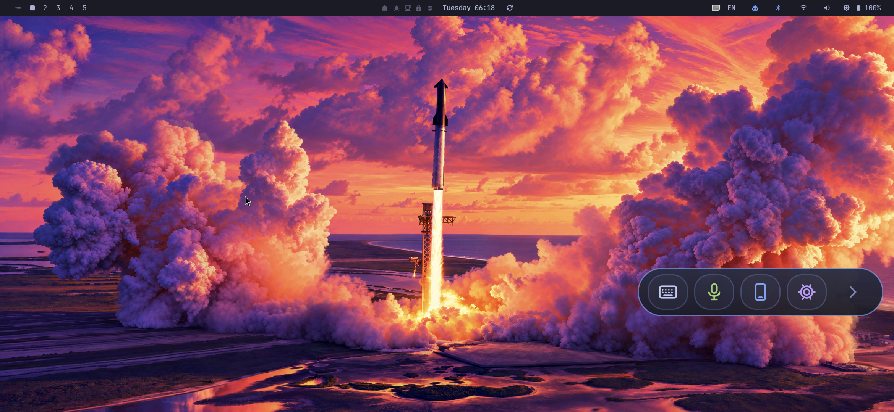

<div align="center">
  
  <h1>Omarchy Android</h1>
  <p><strong>你的手机，也是一台真正的 Linux 桌面。</strong></p>
  <p>为 Android 触控、键盘与日常折腾打造的 Omarchy 风格 Ubuntu ARM64 桌面。</p>
  <p>
    <a href="https://github.com/Audrey-cn/omarchy-android/releases"></a>
    <a href="apps/android/COPYING"></a>
    
    
    <a href="https://github.com/Audrey-cn/omarchy-android/forks"></a>
    <a href="https://github.com/Audrey-cn/omarchy-android/issues"></a>
  </p>
  <p><a href="README.md"><strong>English</strong></a> | <strong>简体中文</strong></p>
  <p><a href="https://github.com/Audrey-cn/omarchy-android/releases"><strong>下载 APK</strong></a> · <a href="docs/initial-install.md">安装指南</a> · <a href="CONTRIBUTING.md">参与贡献</a></p>
</div>

## 实机展示

| Sway 桌面与贴边控制栏 | 透明悬浮键盘 |
| --- | --- |
|  |  |
| **常用控制，集中设置** | **选择、下载或导入桌面** |
|  |  |

## 为什么选择 Omarchy Android？

- **默认免 Root。** 安装 Android App，即可在应用内配置 Ubuntu。内置 X11 与 PRoot，无需单独安装 Termux；已 Root 的设备也可选择 **Root chroot** 路线。
- **真正的 Wayland 会话。** Sway、Waybar、原生应用网格、主题和 Linux 应用运行在 Ubuntu 24.04 ARM64 内。Sway 通过 X11 后端，连接 Android 内嵌的 X 服务器完成显示。
- **一步手势直达。** 贴边悬浮手柄可直接调起 Android 输入法、切换透明悬浮键盘，也可展开横竖屏与设置控制。手柄可调整高度并吸附左右边缘。
- **兼顾触控与键盘。** Android 输入法穿透、中文输入、可调缩放和 Super / Alt 快捷键，让手机、折叠屏和平板也能顺手使用桌面。
- **各自更新，各有节奏。** APK、桌面组件、图形/浏览器运行时和初装镜像独立发行。兼容的同签名 APK 覆盖升级保留既有 guest；Ubuntu 软件包使用 APT，guest 组件由用户在桌面内显式更新。

从 Alacritty、Thunar、Neovim、Lazygit、imv、Zathura、mpv 和 Chromium 开始，再按需通过安装器添加 CC Switch、Codex / ChatGPT Desktop、Claude Desktop 或 Hermes Desktop。两条运行路线的区别见[架构说明](docs/ARCHITECTURE.md)。

## 快速开始 · 30 秒读懂

准备一台 **ARM64 Android 设备**，并为下载文件、解压后的桌面及安装器提示的余量留出空间。下载与解压时间取决于网络和设备。

| 步骤 | 操作 |
| --- | --- |
| **1 · 安装 App** | 从 [Releases](https://github.com/Audrey-cn/omarchy-android/releases) 下载 `arm64-v8a` APK，安装并打开 Omarchy Android。 |
| **2 · 配置 Ubuntu** | 选择兼容镜像，点击**下载并安装桌面**，支持暂停与续传。离线安装时，先选择对应镜像，再导入原始 `rootfs.tar.zst`。 |
| **3 · 启动桌面** | 点击**启动桌面**，按可跳过的四步引导完成设置。使用 `Super + Space` 打开应用网格。 |

[完整安装与更新指南](docs/initial-install.md) · [公开镜像目录](https://github.com/Audrey-cn/omarchy-android/releases/tag/desktop-images)

### 四个贴边手柄手势

| 手柄手势 | 功能 |
| --- | --- |
| **轻点** | 展开控制栏，使用键盘、输入法、横竖屏锁定与统一设置。 |
| **双击** | 显示或收起透明悬浮键盘。 |
| **长按（350 毫秒）** | 轻震后调起 Android 输入法；搭配豆包输入法进行中文与语音输入。 |
| **拖动** | 自由调整高度，自动吸附左侧或右侧屏幕边缘。 |

### 六个核心快捷键

| 快捷键 | 功能 |
| --- | --- |
| `Super + Space` | 打开应用网格 |
| `Super + Enter` | 打开 Alacritty 终端 |
| `Super + W` | 关闭当前窗口 |
| `Super + 1` … `5` | 切换工作区 |
| `Super + K` | 打开完整快捷键速查表 |
| `Super + Alt + Space` | 打开 Omarchy 菜单 |

**Super / Alt 双修饰键：**免 Root 桌面默认启用双修饰键模式，前五项快捷键可将 `Super` 换成 `Alt`。键盘设置也提供「仅 Super」和「仅 Alt」模式；上表的菜单组合键同时使用两枚修饰键。`Super` 通常对应 Windows / Command 键。当前配置以 `Super + K` 速查表为准。

### 五个上手提示

1. **首次镜像优先用 Wi-Fi 下载。** 手机下载较慢时，可在其他设备取得匹配的原始 `rootfs.tar.zst` 后复制到手机，使用离线导入。安装器会核对大小与 SHA-256。
2. **试试外接键盘与豆包输入法。** 蓝牙或 USB 键盘更适合终端工作；如果 Android 截获了 Super 快捷键，可使用支持的 Alt 模式。在 Android 输入法选择器中选用豆包，进行中文/语音输入。
3. **调整显示缩放。** 桌面默认 **1.5×** 缩放，可点击顶栏的显示器图标调整。
4. **Android 12+ 留意子进程限制。** 会话以 **Signal 9** 退出时，打开 App 内的说明，并检查开发者选项中的「停止限制子进程」等设置。具体名称与可用性因设备而异。
5. **允许后台运行。** 将 Omarchy Android 的电池策略设为**不受限制**或厂商对应选项，减少电池管理中断桌面会话的机会。

## 固定版本与维护

| 组件 | 基线版本 | 更新方式 |
| --- | --- | --- |
| **Chromium** | **128.0.6613.18** | 与配套 Playwright / Node 一同定版，保留已测 PRoot 兼容性与稳定性；通过项目运行时通道维护。 |
| **Hermes Desktop** | **2026.9.7-7** | 安装器使用经过审核的固定构建，配套原生模块与首次引导修复。 |
| **Ubuntu** | **24.04 ARM64** | 在既有 guest 内继续进行常规 Ubuntu **APT 更新**。 |

固定版本记录了兼容性基线。版本选择、浏览器安全更新边界、组件升级与恢复操作见[维护总览手册](docs/MAINTENANCE.md)、[运行时维护](docs/runtime-components.md)和[第三方更新说明](docs/third-party-updates.md)。

APK 与初装镜像各有用途：更新 App 使用兼容的同签名 APK，更新 guest 使用桌面更新工具；新初装镜像供新安装选择。[详细说明](docs/initial-install.md)。

## 可选 Root chroot 与开发路线

已 Root 的 ARM64 设备可使用独立的 chroot 运行时，配合外部 Termux:X11 与硬件输入支持。运行前请先阅读[前置条件与安装指南](docs/root-chroot.md)：

```bash
git clone https://github.com/Audrey-cn/omarchy-android.git
cd omarchy-android
./install.sh --mode chroot --inspect
./install.sh --mode chroot
```

安装器只向新的 `/data/omarchy-chroot` 目录安装，发现既有安装时拒绝覆盖。外部 Termux + Termux:X11 PRoot 路线（`./install.sh --mode proot`）保留用于开发与迁移；[Omarchy Deck](apps/deck/) 是这一路线可选的辅助输入 App。构建与操作见[开发指南](docs/DEVELOPMENT.md)。

## Fork、定制与贡献

把桌面改成你喜欢的样子。欢迎 Fork 仓库，制作主题、改进应用安装包、适配新设备，也欢迎在自己的 Fork 中探索其他发行版。可以先在 [Issue](https://github.com/Audrey-cn/omarchy-android/issues) 中提出具体想法，再通过 PR 贡献成熟的改进。设备报告、文档与翻译也同样有价值。

[CONTRIBUTING.md](CONTRIBUTING.md) 提供目录地图、检查命令与 PR 流程。报告设备结果时，请注明准确的 Android 版本、运行路线与测试构建；已有 [K20 Pro 验证记录](docs/reports/update-maintenance-k20-20261124.md)展示了当前实测范围。

| 想了解什么 | 从这里开始 |
| --- | --- |
| 共享桌面脚本、主题与配置 | [`core/`](core/) |
| Android App、安装器与悬浮控制 | [`apps/android/`](apps/android/) |
| Root 与外部 Termux 运行时 | [`runtime/`](runtime/) |
| 发版通道与恢复操作 | [维护总览手册](docs/MAINTENANCE.md) |
| 构建与测试 | [开发指南](docs/DEVELOPMENT.md) |
| 个人配置迁移 | [`scripts/backup-personal.sh`](scripts/backup-personal.sh) |

## 许可证与致谢

Android 应用基于 Caten Hu 的 **[Tiny Container](https://github.com/Cateners/tiny_container)**，沿用 **GPL-3.0-or-later** 及原有声明，详见 [COPYING](apps/android/COPYING)。共享桌面核心、Termux 运行时、Deck 与本仓原创文档沿用根目录的 [MIT 许可证](LICENSE)。第三方代码、主题、字体和工具保留各自许可证，组件边界见 [LICENSES.md](LICENSES.md)。

感谢 [Omarchy](https://github.com/basecamp/omarchy) 的桌面设计灵感、[Tiny Container](https://github.com/Cateners/tiny_container) 的 Android 容器基础，以及 [Termux:X11](https://github.com/termux/termux-x11)、[PRoot](https://github.com/proot-me/proot)、[Sway](https://github.com/swaywm/sway)、[wlroots](https://gitlab.freedesktop.org/wlroots/wlroots) 和这些项目的贡献者。

## 支持项目

由 [Audrey](https://github.com/Audrey-cn/omarchy-android) 维护。如果这个项目对你有帮助，欢迎通过 [GitHub Sponsors](https://github.com/sponsors/Audrey-cn) 支持后续开发，也可以在[仓库](https://github.com/Audrey-cn/omarchy-android)贡献设备报告、翻译或修复。
