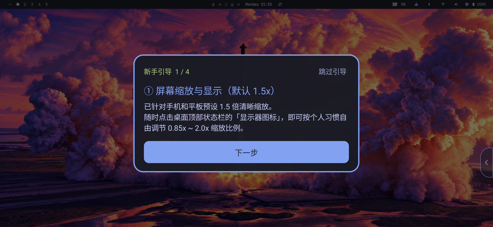

# 在线初装与独立 App 更新验收（2026-11-23）

本轮交付精简 APK、可续传的首次安装和独立初装镜像。Ubuntu 软件使用 APT 源；App、X11 与 PRoot 独立发版，普通启动不向已有 guest 同步文件。

## 发布与构建来源

- App：[v1.0.72-test](https://github.com/Audrey-cn/omarchy-android/releases/tag/v1.0.72-test)，附件 OmarchyAndroid-1.0.72-test.apk。大小 **33,745,476 字节**，SHA256 **7387172a0e81677beb2d4189bc0116ef3f78e70b036703709c995d19f6971804**。来源提交 e76c3e8577aa8d294f5c2ec93e0bae8ad0aa053a；[可信 main 云端构建](https://github.com/Audrey-cn/omarchy-android/actions/runs/45176504196)通过编译、单测、打包、版本、持久签名与原生库校验。
- [Ubuntu 24.04 ARM64 初装镜像](https://github.com/Audrey-cn/omarchy-android/releases/tag/desktop-ubuntu24-e55030353df6)：来源 e55030353df6bae7496720356f2d4b940495824e，[镜像构建](https://github.com/Audrey-cn/omarchy-android/actions/runs/45165450697)；压缩大小 **999,745,976 字节**，普通文件逻辑总量 **2,973,377,562 字节**，SHA256 **88a1558fc93489016ad1c53fccb03ebc0f3986507dccf6b422de444d915f33c6**。
- [可用初装镜像目录](https://github.com/Audrey-cn/omarchy-android/releases/tag/desktop-images)和版本化镜像均为非 latest。目录为同一镜像增加官方 GitHub API 附件地址，并保留原网页地址；镜像内容、来源和校验值未变。刷新目录通过固定 Release 标签动态解析 catalog.json 的当前附件 ID，APK 自带兼容目录作为回退。
- 完整云端附件、镜像 SHA 和 175,306 个归档条目已核验：无未物化硬链接、设备节点、运行时挂载内容、手机用户数据或 Hermes 凭据。machine-id 在镜像中留空，每次初装单独生成。Chromium 128、Playwright 1.46.1、Node 24.15.0、软件包清单及许可/来源凭据随镜像提供。
- 精简 APK 无 rootfs 或受管 Linux 载荷，保留 App 界面、内嵌 X11、只读原生 PRoot 及配套加载器。后续验收包的测试代理代码只编译进 acceptance，普通发行包不包含该代理配置。

## K20 Pro：原有环境升级

在 user 0 上执行普通 install-r，从 62 升级到 72，未卸载、清除数据或重新导入日常环境。

- 持久签名证书一致，应用 UID 保持一致。
- 13 项关键文件在安装前、安装后和正常启动后校验值一致，包含 Hermes 配置与密钥文件、容器配置、Sway 配置、软件包数据库、X11/悬浮设置、旧受管收据和浏览器入口/来源文件；公开收据只保留一致性结果。
- 原输入法保持不变。旧受管启动同步调用已移除，浏览器、Node、桌面脚本和个人设置保持原状。
- 冷启动进入实际桌面。已有引导完成偏好保留。

证据：[覆盖升级](evidence/k20-online-app-update-20261123.json)、[启动后保留](evidence/k20-online-app-preservation-20261123.json)。

## K20 Pro：首次安装与续传

使用临时、独立包名和 UID 的验收包执行实际 Activity、前台服务和首次安装流程，日常包的数据没有用于清洁初始化。

| 路径 | 实际结果 |
| --- | --- |
| 离线安装 | 系统文件选择器选中匹配镜像，核对手机端完整 SHA；实际解压、aid 映射、machine-id 初始化和登记完成；暂存目录清空。 |
| 直连目录 | Android App 通过官方 GitHub API 获取并缓存当前镜像目录成功。 |
| 直连续传 | 下载到 5,903,787 字节，暂停并结束进程，磁盘保留相同前缀；重开新进程后从相同偏移继续，观测增长到 6,190,507 字节。另一次下载中直接结束进程后仍保留 7,452,075 字节，重开显示可继续。 |
| 完整 HTTPS 续传 | 下载到 599,611,696 字节，暂停、结束进程、重开后保留精确偏移；后续进度未归零，下载至 999,745,976 字节，另行执行手机端 SHA256 核验一致，再实际解压、配置、登记完成。 |
| 全新桌面与浏览器 | 离线初装环境实际进入 Sway/Waybar，Chromium 128 显示 Example Domain；配套 Playwright 的真实 headless 浏览器自检通过。 |

**网络条件：** K20 当前网络访问 github.com 网页域名超时，官方 API 和附件服务器可达但大文件直连约 26 KB/s。直连目录与部分续传均实测通过；完整 1 GB 测试使用仅对临时 acceptance 包生效的测试代理和单个 ADB 端口转发。全程下载真实官方 HTTPS 数据，保留正常 TLS 和长度/ETag/Range/SHA 校验，没有预填镜像或模拟进度，也未更改手机的全局代理。该结果不代表 K20 直连能达到同等吞吐速度。

证据：[离线流程](evidence/k20-online-offline-install-20261123.json)、[直连恢复](evidence/k20-online-direct-resume-20261123.json)、[完整镜像](evidence/k20-online-full-image-20261123.json)。

## 引导与恢复边界

新手引导等待当前 X11、Sway、Waybar 和视口稳定后显示，实测引导背后已出现壁纸和顶栏。首步不再用猜测坐标将箭头指向错误图标；贴边手柄仍使用自身位置引导。跳过写入独立 opt-out，未冒充四步完成；另一次全新环境实际走完四步后才写入完成标记。系统通知面板覆盖桌面期间检测超时后，重试成功恢复引导。

初装在独立暂存目录校验、配置后发布，只写入缺席的 omarchy 目录；未知的已有 guest 不会被替换。已补齐带所有权记录的中断暂存清理、发布后未登记恢复、离线缓存回收、同步登记后才报告完成，以及后台取消/串行重试。低空间和断电边界使用真实文件系统/工作队列回归测试；本轮未执行手机实际断电或耗尽存储测试。

## 真实 Hermes Agent

沿用 K20 原 Hermes 的 qwen3.8-flash / custom / chat_completions 配置。验收临时 profile 只在手机内引用原模型端点和所选密钥，日常配置和私密 URL 限制保持原样。

收据中的 sourceCommit 是 Hermes 引擎提交 2237be355906fbe6065ce1815711eee52b2d646e；App 二进制来源仍是上文的 e76c3e8。离线流程收据的 sourceBranchCommit 标记早期临时验收包，未冒充最终 APK 来源。

真实 AIAgent.run_conversation 完成 **7 次模型调用、6 次 CDP 工具调用，8 项端到端检查通过**：中文 DOM、确认点击、浏览器下载、唯一目标文件及内容、PNG 截图等。模型有一次不受支持的工具调用报错，随后自行恢复，不能将本次描述为所有工具调用均成功。PNG 为 2289×851、63,893 字节。

[脱敏收据](evidence/k20-online-agent72-20261123.json)只保存允许的状态、检查和受控测试产物信息，不含密钥、请求头或私密模型端点。临时模型 profile 已移除。

## 验证范围

下载器 30 项 JVM 测试、目录/事务/控制 33 项 JVM 测试、引导 19 项专项测试及 112 项 Python 测试构成回归覆盖；云端执行实际 Android 编译、单测和原生/签名/布局校验。独立审查发现的恢复、生命周期和首次引导问题均已修正并复审。

Root chroot 的完整冷安装与独立分区启动属于后续集成/讨论，本轮不将它们列为已交付功能。现有 Ubuntu 的大版本迁移、全部可选 AI 应用的登录业务及所有机型性能对比也不属于本轮验收。

## 收尾

临时验收包及其 Linux 数据、单个 ADB 测试转发、手机中的测试离线镜像和临时模型 profile 均已移除；日常一体 App 和原有环境保留。[清理收据](evidence/k20-online-cleanup-20261123.json)。旧 App 发行版和初装镜像历史保留在 GitHub Releases。
